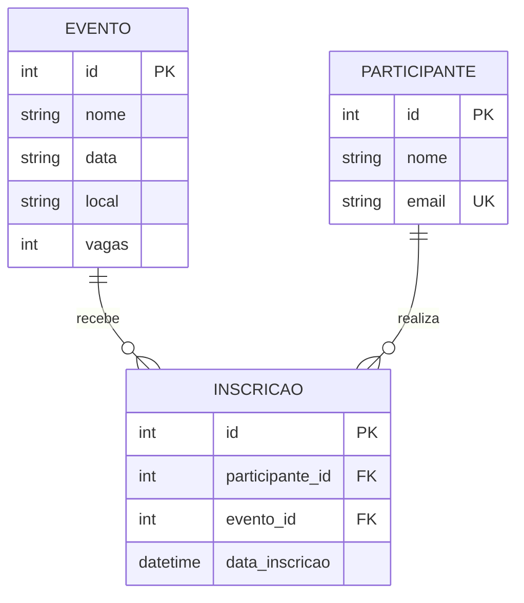

# DER — Sistema de Eventos Acadêmicos

## Integrantes

- Pâmela Roberta de Souza Custódio
- Adriana Carla Rodrigues Moura

## Diagrama

## Relacionamentos

- Um evento pode receber nenhuma ou várias inscrições.
- Um participante pode realizar nenhuma ou várias inscrições.
- Cada inscrição pertence a exatamente um evento e um participante.
- Evento e Participante formam uma relação muitos para muitos,
  resolvida pela entidade Inscricao.

## Regras implementadas

- O nome e a data do evento são obrigatórios.
- A quantidade de vagas pode ficar vazia ou ser um inteiro
  maior ou igual a zero.
- O nome e o e-mail do participante são obrigatórios.
- O e-mail do participante deve ser único.
- O mesmo participante pode ter somente uma inscrição por evento.
- A data de inscrição é preenchida automaticamente.
- Ao excluir um evento ou participante pelo ORM, suas inscrições
  também são excluídas.

## Situação da implementação

Os três modelos estão definidos no banco de dados.

A interface atual permite cadastrar, listar, editar e excluir eventos.
As telas de participantes e inscrições ainda não foram implementadas.
O limite de inscrições pela quantidade de vagas ainda não é validado.